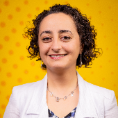
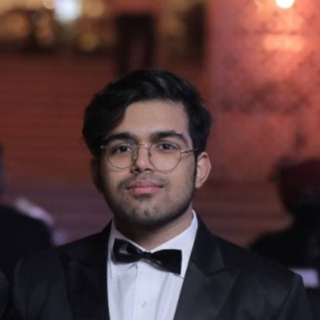

# Meet Your Faculty

The assignment of faculty to individual modules is to be announced.

## Instructors

#### Hosna Jabbari

<small>Photo: <a href="https://www.ualberta.ca/en/engineering/about/news/2026/january/u-of-a-teams-with-moderna-to-harness-power-of-mrna-medicines.html">University of Alberta Faculty of Engineering</a>.</small>

> University of Alberta  
Edmonton, Alberta

Bio: To be announced.

#### Mark Berjanskii

> University of Alberta  
Edmonton, Alberta

Bio: To be announced.

## Teaching Assistants

#### Amirali Loghmani

Bio: To be announced.

#### Utkarsh Kalra

Bio: To be announced.

<!--TEMPLATE FOR EACH FACULTY MEMBER:
#### NAME

>JOB TITLE  
INSTITUTION  
LOCATION
>
> --- CONTACT INFO, IF PROVIDED

BIO GOES HERE-->
