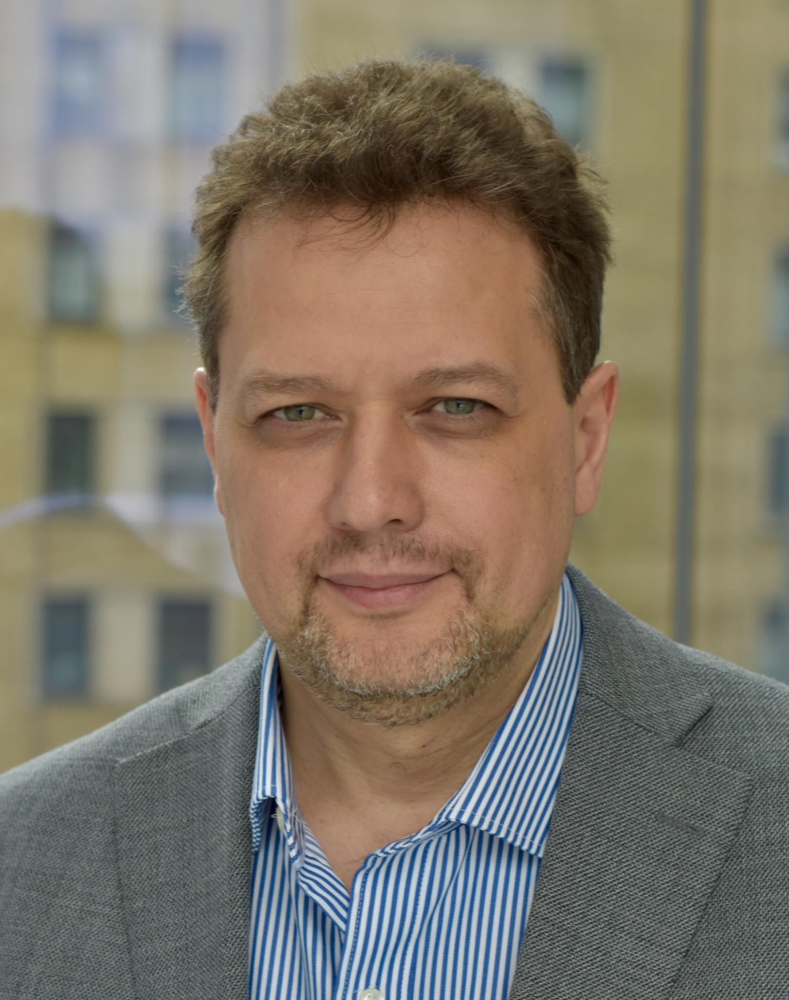
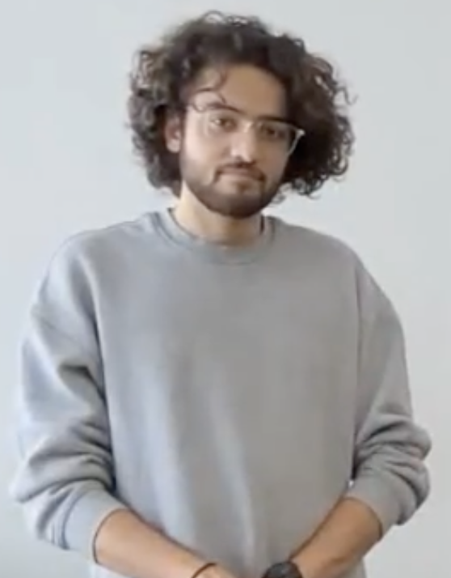

# Meet Your Faculty

Meet the instructors and teaching assistants for the CBW Large Language Models
for Bioinformatics workshop. Instructor assignments for individual modules
will be announced.

## Instructors

#### Hosna Jabbari

<small>Photo: <a href="https://www.ualberta.ca/en/engineering/about/news/2026/january/u-of-a-teams-with-moderna-to-harness-power-of-mrna-medicines.html">University of Alberta Faculty of Engineering</a>.</small>

> Engineering Research Chair in Computational Biology 
> University of Alberta 
> Edmonton, Alberta

Dr. Hosna Jabbari is a computational biologist and Engineering Research Chair
in Computational Biology at the University of Alberta. She leads the COBRA Lab,
where her group studies RNA structure and function using bioinformatics,
machine learning, and data science.

#### Mark Berjanskii

> Research Associate 
> University of Alberta 
> Edmonton, Alberta

Dr. Mark Berjanskii earned a PhD in Biochemistry from the University of
Missouri–Columbia in 2002, studying oncoviral protein structure and dynamics
with NMR. After postdoctoral research in protein structural biology at the
University of Michigan, he joined David Wishart’s group at the University of
Alberta to work on metabolomics, NMR, and protein structure.

## Teaching Assistants

#### Amirali Loghmani

> Teaching Assistant 
> University of Alberta 
> Edmonton, Alberta

Amirali Loghmani is an MSc student in Biomedical Engineering at the University
of Alberta. His research uses deep learning to study SARS-CoV-2 mutations and
potential variants of concern.

#### Utkarsh Kalra

> Teaching Assistant 
> University of Alberta 
> Edmonton, Alberta

Utkarsh Kalra is an MSc student in Biomedical Engineering and a Graduate
Research Assistant in the COBRA Lab. His work includes machine-learning models
of protein–RNA binding and analysis of single-cell genomic data.
