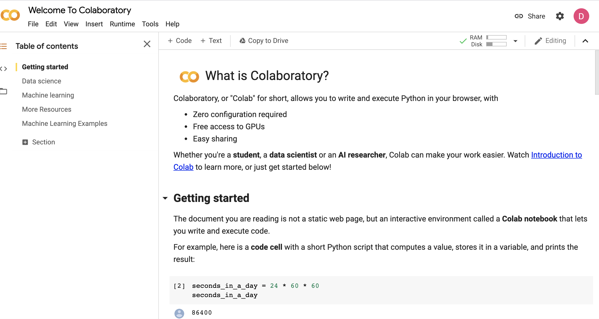
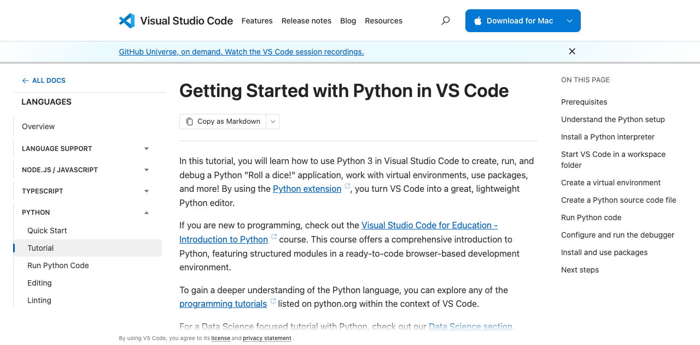

# Get Ready: LLMs in Bioinformatics

## Student pre-work | November 14–15, 2026

**Required check: about 10 minutes. Optional local Python setup: about 20–30 minutes.** You do not need to be an expert or have every tool installed before you arrive.

## 1. Bring a laptop and sign in to Colab

Bring a laptop and charger. Open [Google Colab](https://colab.research.google.com/) and sign in with a Google account you can use in a browser. Use an existing account, or [create a Google Account](https://accounts.google.com/signup) if needed. The workshop's basic access check does not require a paid plan or GPU.

Follow the live Colab page: controls can differ by account and change over time. The nearly empty signed-out landing capture has been omitted because it does not help with setup.

The example below comes from Module 1 of the April 2026 Machine Learning workshop. It shows the parts of a Colab notebook (code cell, output, and notebook controls); it is a historical illustration, not a current screenshot or a required workshop notebook.



*Source: Module 1 lecture, Machine Learning workshop (April 2026), slide titled “Colab Main Page.” The current Colab layout may differ.*

When the workshop Colab notebook link is shared, open it and follow its instructions. If you are just checking access, choose **New notebook** and run this in a code cell:

```python
print("Hello, bioinformatics!")
```

You are ready when the cell runs and displays the message. In a provided notebook, choose **File > Save a copy in Drive** before editing. Colab's runtime is temporary and can reset; save your notebook and download files you need to keep. See the [Colab FAQ](https://research.google.com/colaboratory/faq.html).

## 2. Use the slides and notebook together

For each hands-on activity, open the relevant workshop slides and the linked notebook side by side. The slides introduce the question and explain the science; the notebook contains executable cells and step-by-step directions.

1. Open the module's notebook from the link in its slides or the workshop site.
2. Save a copy to your Drive before making changes.
3. Read the notebook's setup notes first; run cells in order and inspect outputs as you go.
4. Return to the slides at each activity checkpoint to connect the result to the concept.

**Workshop notebook links will be added by the organizers before the package is sent.** Do not substitute notebooks from a different machine-learning workshop; their dependencies and data are not the LLM workshop labs.

## 3. Optional: set up Python in VS Code

This is optional unless your instructor later confirms a local lab requirement. VS Code is an editor; Python is a separate interpreter that runs your code. The screenshot below is Microsoft's current official Python tutorial, not a screenshot of an installed local editor.



*The Microsoft tutorial is updated independently. If the page looks different, follow the current [Getting Started with Python in VS Code](https://code.visualstudio.com/docs/python/python-tutorial) instructions.*

1. Install [Python 3](https://www.python.org/downloads/) and [Visual Studio Code](https://code.visualstudio.com/).
2. In VS Code, install Microsoft's **Python** extension. Install the **Jupyter** extension only if you plan to run `.ipynb` notebooks locally.
3. Open a new folder in VS Code, create `hello.py`, and run:

```python
print("Hello, bioinformatics!")
```

4. Optional: create a project-specific environment from VS Code's **Command Palette > Python: Create Environment > Venv**. Or, from a terminal opened in your project folder, run:

```bash
# macOS / Linux
python3 -m venv .venv
```

```powershell
# Windows PowerShell
py -3 -m venv .venv
```

5. Activate the environment if you are using the terminal:

```bash
# macOS / Linux
source .venv/bin/activate
```

```powershell
# Windows PowerShell
.venv\Scripts\Activate.ps1
```

6. In VS Code, select `.venv` with **Command Palette > Python: Select Interpreter**. For local `.ipynb` work, install Microsoft's **Jupyter** extension, then choose the `.venv` kernel from the notebook's kernel picker. If VS Code prompts you to install `ipykernel` into `.venv`, accept that prompt; do not install other lab libraries until instructors provide the exact requirements.

See Microsoft's [Python tutorial](https://code.visualstudio.com/docs/python/python-tutorial) and [Jupyter notebook guide](https://code.visualstudio.com/docs/datascience/jupyter-notebooks).

## 4. Protect your data and accounts

- Use workshop examples or instructor-approved public/synthetic practice data in Colab and AI tools.
- Do not upload identifiable, clinical, confidential, unpublished, or restricted data to a personal Drive, Colab, or an AI service.
- Only mount Google Drive when an instructor-provided notebook explicitly requires it and you have reviewed the code and access request.
- Never put passwords, API keys, or access tokens in a notebook, slide, or prompt.

## 5. Optional: education and research AI access

Neither GitHub Copilot nor a paid Claude plan is required for this workshop. These are optional programs with their own eligibility checks; do not purchase a plan for the workshop.

### GitHub Copilot Student

Students enrolled in a degree- or diploma-granting program may apply for GitHub Education, subject to GitHub's verification. A workshop attendee or short-course participant is not automatically eligible. You will need a personal GitHub account and current proof of enrollment (for example, a current student ID, class schedule, transcript, or enrollment letter); GitHub may require a verified academic email.

1. Sign in to your GitHub account and open [Education benefits](https://github.com/settings/education/benefits).
2. Under GitHub Education, choose **Start an application**, complete the form, and submit current enrollment evidence.
3. After approval, return to Education benefits and activate **Copilot Student** from the student benefits. Education approval and Copilot activation are separate steps; activation may take several days.
4. If GitHub only shows a paid checkout, do not purchase to claim the student benefit. Wait a few days and check again, or contact GitHub Support.

GitHub currently describes Copilot Student as free for verified students, with eligibility rechecked monthly. Features and usage limits can change; review the official [student setup instructions](https://docs.github.com/en/copilot/how-tos/copilot-on-github/set-up-copilot/enable-copilot/set-up-for-students) and [student eligibility/application guidance](https://docs.github.com/en/education/about-github-education/github-education-for-students/apply-to-github-education-as-a-student).

### Anthropic Claude access for academic PIs

Anthropic's [Claude Team plan for scientists](https://www.anthropic.com/news/expanding-support-for-scientists) is a separate, PI-led offer, not a general student license. Anthropic's announcement says a principal investigator (or equivalent) at an academic or nonprofit research institution must complete verification; after approval, the PI can add researchers in their lab. The announced offer provides standard seats at no cost and premium seats for US$15 per month, for one year, subject to the program's current availability and terms. A PI should review the current verification form linked from Anthropic's announcement and confirm the live terms before enrolling lab members. Individual students should ask their PI whether the lab has access; do not assume a workshop registration qualifies.

For research needing additional API credits, Anthropic separately accepts applications to its [AI for Science program](https://www.anthropic.com/news/expanding-support-for-scientists); that is a project application and is not the same as a Claude subscription. Neither program is required for this workshop. Do not submit sensitive research data during setup or use personal Claude access with restricted data unless your institution has approved it.

## 6. Optional: GitHub and coding assistants

These tools are optional preparation, not requirements for the basic Colab check. Choose one workflow rather than installing everything. Do not buy a plan or add an API key for this pre-work. Instructions and official sources below were checked November 9, 2026; follow live vendor guidance if controls change.

### Create a GitHub account

Reuse your personal account if you already have one. Otherwise visit [GitHub signup](https://github.com/signup), follow the prompts, choose a username, and verify your email. A free account is sufficient. Enable two-factor authentication and keep recovery codes private. Then confirm you can sign in. GitHub Education verification remains a separate application; creating an account does not activate student benefits. See [GitHub's account instructions](https://docs.github.com/en/account-and-profile/how-tos/account-management/creating-an-account-on-github).

### Enable the GitHub Copilot extension in VS Code

Update VS Code. Open **View > Extensions**, search for **GitHub Copilot**, and use the official GitHub extension, identifier `GitHub.copilot-chat`, if installation is needed. Current VS Code also offers **Copilot icon > Use AI Features**, which starts setup. Sign in with your GitHub account and confirm the correct account/plan; eligible accounts can use Copilot Free with usage limits, or existing institutional/verified Student access. In a disposable folder containing `hello.py`, ask Copilot to explain the script, then check its answer. Do not enable unrestricted agent execution for this test. See [official VS Code setup](https://code.visualstudio.com/docs/setup/copilot/) and the [official extension listing](https://marketplace.visualstudio.com/items?itemName=GitHub.copilot-chat).

### Install the standalone GitHub Copilot app

This is the **GitHub Copilot app**, not GitHub Desktop or Microsoft Copilot. Install Git first, then use [GitHub's official downloads](https://github.com/github/app) for your operating system and CPU. Run the platform installer, open the app, and sign in. Use existing Copilot access or Free/verified Student access if available. Add a disposable local folder and start an **Interactive** session. Ask for an explanation first, then inspect changes and command approvals before proceeding. Follow the [official app quickstart](https://docs.github.com/en/copilot/get-started/quickstart-copilot-app).

### Install and try Freebuff

**Before installation:** use a separate OS account/environment with no access to personal/research files or secrets, or an appropriately configured container. This does not mean merely creating a different Freebuff login. If you cannot arrange isolation, skip installation and ask a teaching assistant for help.

Read the terms and privacy policy, then download the desktop installer for your OS and CPU from [Freebuff](https://freebuff.com/). Install and complete sign-in/onboarding only in the isolated environment. It is an optional, ad-funded service; check live availability and terms. Its [CLI page](https://freebuff.com/cli) offers a separate terminal workflow, not needed here.

The [privacy policy](https://freebuff.com/privacy-policy), effective November 12, 2026, describes project-data processing, advertising uses, and agent access beyond the selected project. **Selecting a project is not sandboxing.** Do not connect private research repositories for this exercise.

Create a disposable practice folder and make `hello.py` containing `print("Hello, bioinformatics!")`. Open that practice folder and try: **Explain hello.py. Do not edit files or run commands.** This prompt is an instruction, not an enforced security boundary. Inspect proposed edits and commands, check outputs, and keep a backup. A desktop AI app is not necessarily local-only.

## 7. Optional: bring your own data

Workshop example data will be available; bringing your own data is not required. If you wish, prepare a small public or synthetic example you have permission to use and one clear biological or analysis question. Prefer a compact CSV/TSV or a small sequence example rather than a full dataset.

Include a README or data dictionary describing column names, units, identifiers, provenance/licensing, and your expected output. Keep an untouched original and bring a working copy. Have an instructor check suitability before using it in the exercises; not every dataset will fit the workshop activities or compute limits.

Do not upload patient-level, clinical, confidential, restricted, or unpublished research data to Colab, GitHub, Copilot, Freebuff, or another AI service for this exercise. Human genomic data may remain identifying even after names are removed. If your actual data are sensitive, bring only a schema, public surrogate, or synthetic example. A private GitHub repository or local desktop app does not itself authorize cloud/AI processing. Any future use of restricted data needs the appropriate institutional approvals and approved infrastructure, outside this pre-work exercise.

## If setup does not work

Note your operating system and the step that failed. Bring the exact error message with personal information and secrets removed; a teaching assistant can help. You do not need to install GitHub Copilot or purchase a service for this pre-work.

## Official references

- [Google Colab](https://colab.research.google.com/)
- [Colab FAQ](https://research.google.com/colaboratory/faq.html)
- [Python downloads](https://www.python.org/downloads/)
- [VS Code Python tutorial](https://code.visualstudio.com/docs/python/python-tutorial)
- [Jupyter notebooks in VS Code](https://code.visualstudio.com/docs/datascience/jupyter-notebooks)
- [GitHub Copilot Student setup](https://docs.github.com/en/copilot/how-tos/copilot-on-github/set-up-copilot/enable-copilot/set-up-for-students)
- [Apply to GitHub Education as a student](https://docs.github.com/en/education/about-github-education/github-education-for-students/apply-to-github-education-as-a-student)
- [Anthropic: Claude access for scientists](https://www.anthropic.com/news/expanding-support-for-scientists)
- [GitHub account creation](https://docs.github.com/en/account-and-profile/how-tos/account-management/creating-an-account-on-github)
- [Copilot in VS Code](https://code.visualstudio.com/docs/setup/copilot/)
- [GitHub Copilot app quickstart](https://docs.github.com/en/copilot/get-started/quickstart-copilot-app)
- [Freebuff downloads](https://freebuff.com/)
- [Freebuff privacy policy](https://freebuff.com/privacy-policy)

*Screenshot note: screenshots in this package were captured November 9, 2026. They illustrate the labeled screens only and are not a guarantee that every account sees the same interface.*
*The Colab notebook example from the April 2026 MLE Module 1 lecture is explicitly historical; only the signed-out landing page and VS Code tutorial screenshots are November 2026 captures.*
